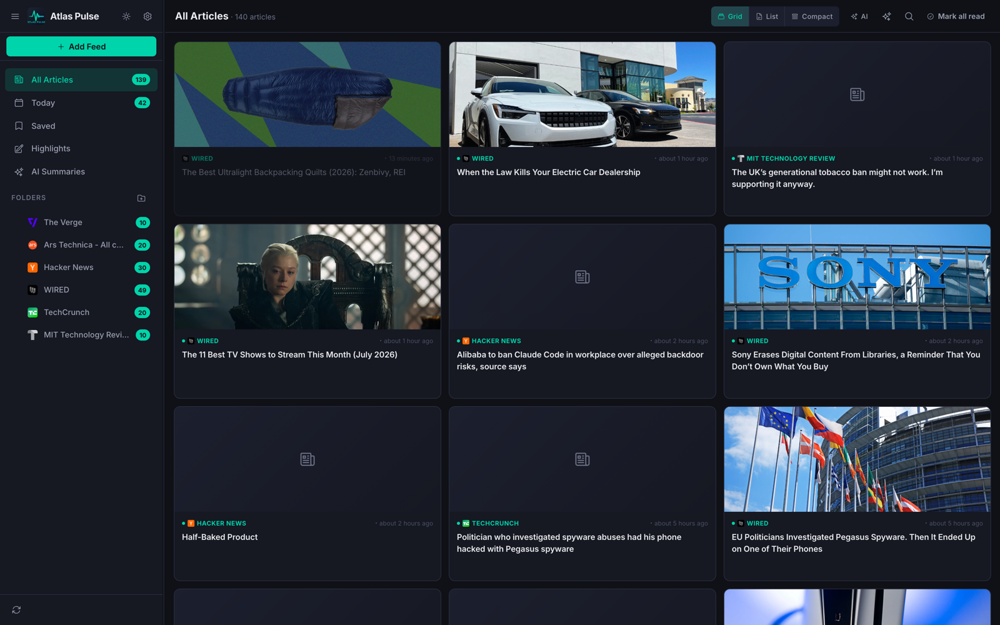
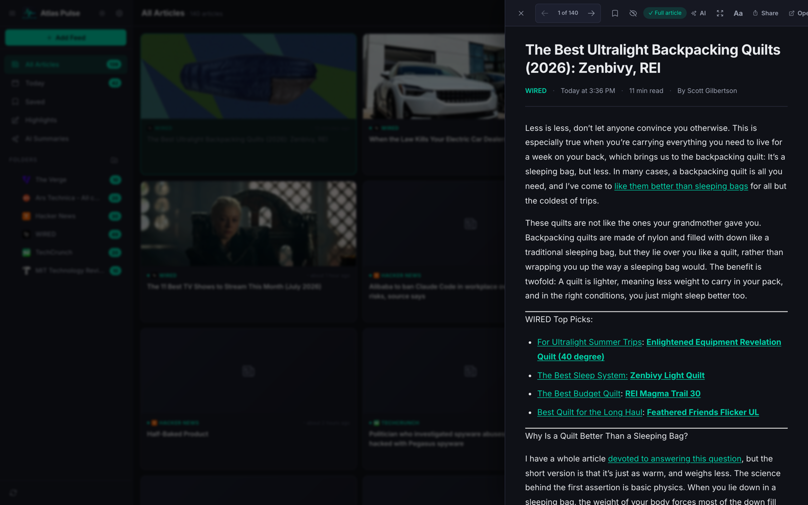
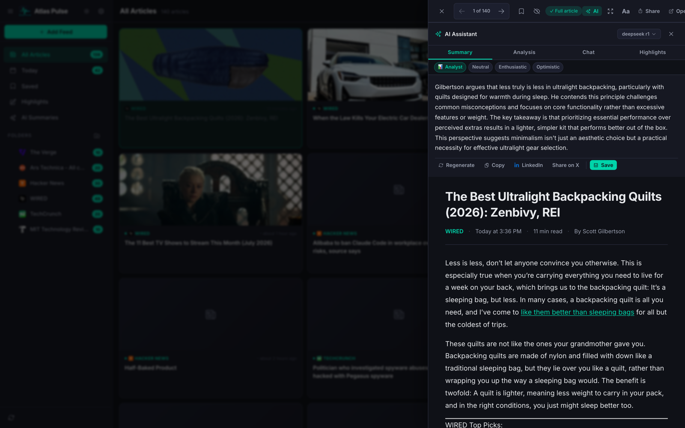
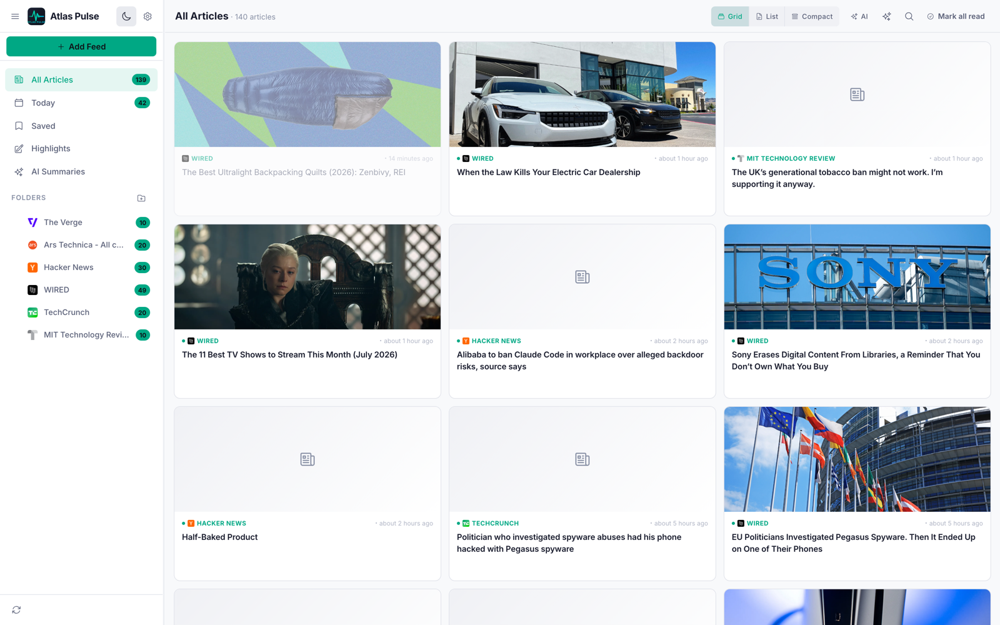

# Atlas Pulse — Personal RSS Feed Reader


A modern, privacy-first RSS feed reader that runs entirely on your own machine. No cloud services, no subscriptions, no accounts — your feeds, articles, highlights, and summaries live in local SQLite files.

AI summaries, content analysis, and article chat run **on-device**. By default Atlas Pulse uses **Gemini Nano**, the model built into desktop Google Chrome, so AI works with no installation or setup. **Ollama** remains available as an optional engine for larger local models.



<table>
  <tr>
    <td width="50%">
      
      <p align="center"><em>Reader with automatic full-text extraction</em></p>
    </td>
    <td width="50%">
      
      <p align="center"><em>AI summary, streamed from a local Ollama model</em></p>
    </td>
  </tr>
</table>

<details>
<summary>Light theme</summary>



</details>

---

## Quick Start

### Prerequisites

- **Node.js** v20.19 or later — `node -v`
- **npm** (bundled with Node.js) — `npm -v`
- **Google Chrome** 148 or later, desktop _(recommended — enables the built-in Gemini Nano AI)_
- **Ollama** _(optional — only if you want larger local models)_ — [ollama.com](https://ollama.com)

### Run the App

```bash
# 1. Clone the repo
git clone https://github.com/socraticsurge/atlas-pulse.git
cd atlas-pulse

# 2. Install dependencies (first time only, or after pulling updates)
npm install

# 3. Start frontend + backend together
npm run dev
```

Open **http://localhost:5173** in Google Chrome.

> **What starts:**
> - Vite dev server on **port 5173** (React frontend)
> - Express API server on **port 3001** (feed proxy, article extraction, SQLite storage, optional Ollama bridge)
> - Vite proxies all `/api/*` requests to Express automatically

Press `Ctrl + C` to stop everything.

### Run in the Background (macOS)

To keep Atlas Pulse available at a fixed address without a terminal open, install it as a login service. It starts when you log in and restarts automatically if it ever exits.

```bash
npm run service install
```

Then open **http://atlas-pulse.localhost:4317**. Chrome resolves every `*.localhost` name to your own machine, so no DNS or hosts-file changes are needed.

| Command | What it does |
|---------|--------------|
| `npm run service install` | Build the app and register the background service |
| `npm run service restart` | Rebuild and restart — run this after pulling updates or changing code |
| `npm run service status` | Show whether the service is running |
| `npm run service logs` | Follow the service logs (`~/Library/Logs/atlas-pulse/`) |
| `npm run service uninstall` | Stop the service and remove it |

The service listens on `127.0.0.1` only and is not reachable from other devices. Set `PORT=<number>` before `install` to use a different port.

---

## Features

### Reading

| Feature | Details |
|---------|---------|
| **Three article views** | Grid (portrait thumbnail cards), List (title + excerpt + thumbnail), Compact (dense single-line rows) |
| **Auto full-text extraction** | Full article pulled from source automatically on open |
| **Reading progress bar** | Accent-colored bar at the top of the reader tracks scroll position |
| **Zen / Focus mode** | Press `f` to expand the reader to full width, hiding all distractions |
| **Keyboard shortcuts** | `j/k` next/prev · `b` bookmark · `o` open original · `f` zen · `Esc` close |
| **Highlights** | Select text in the reader to save it as a highlight in one of four colors |
| **Highlights library** | Browse and search every highlight across articles; export as CSV |

### Organization

| Feature | Details |
|---------|---------|
| **Folders** | Create folders, move feeds into them, right-click to rename or delete |
| **Saved / Bookmarks** | Bookmark any article; find them under "Saved" in the sidebar |
| **Today view** | Shows only articles published today |
| **Search** | AND-logic tokenized search — "cloud AI" matches articles containing both terms across the title, source, AI topics, and article excerpt; quoted phrases for exact match; results ranked by relevance (title › source › AI topics › excerpt). Full-text search is on the [roadmap](docs/TECH-DEBT.md) |
| **Mark all read** | One-click button in the article list header |
| **AI Only filter** | Toggle in the article list header to show only AI-analyzed articles |
| **Content filters** | Per-dimension dropdown pills (Sentiment · Urgency · Frame · Tone · Depth) — shown when AI analysis data is available |

### Appearance

| Feature | Details |
|---------|---------|
| **Dark / Light theme** | Toggle in sidebar header or settings |
| **Collapsible sidebar** | Three states: expanded → icon-only (56 px) → fully hidden |
| **Resizable panels** | Drag the handle between article list and reader to resize |
| **Font picker** | Inter, Poppins, Lato, Nunito, Merriweather, Garamond, Times, Mono, System UI |
| **Accent color** | 6 presets + full custom color picker |
| **Text color** | 4 presets (Cool, Warm, Pure, Soft) + full custom color picker |
| **Reader typography** | Adjustable font size, line width, line height in reader settings |

### Feed Management

| Feature | Details |
|---------|---------|
| **URL discovery** | Paste any URL — feeds auto-discovered from `<link>` tags and common paths |
| **Google News search** | Type a keyword to subscribe to a Google News RSS feed |
| **Popular feeds catalog** | Curated feeds across Technology, AI, Business, Science, and more |
| **OPML import / export** | Move your feeds to/from any other RSS reader |
| **Configurable auto-refresh** | Off, 15 min, 30 min, 1 hr, or 2 hr — set in Settings → Reading |

### AI Features

| Feature | Details |
|---------|---------|
| **Gemini Nano by default** | Uses the on-device model built into Google Chrome — no install, no API key, nothing to configure |
| **Optional Ollama engine** | Connect Ollama for larger local models; a built-in wizard detects, starts, and pulls models |
| **AI Summary** | On-demand 3–4 sentence summary of the current article, streamed in real time |
| **Content Analysis** | On-demand classification across 5 dimensions: Sentiment, Urgency, Frame, Tone, Depth — with topic tags |
| **Article Chat** | Ask any question about the article; streamed responses with full context |
| **Personas & tone** | Choose reading personas, voice, energy, and angle, plus custom instructions applied to every response |
| **Background Batch Processing** | Automatically summarizes and classifies new articles in the background as you read |
| **On-demand batch trigger** | `✨` button in the article list header queues the latest N articles for immediate processing |
| **AI processing indicator** | Spinner with remaining count appears in the header while batch is running |
| **AI Summaries Library** | Save any AI summary to a persistent SQLite library; search, browse, and export as CSV |
| **Studio** | Save a generated newsletter to Studio, then edit its title and Markdown beside a live page in one of three newspaper designs (Broadsheet, Evening Edition, Quarterly); changes save as you type, each newsletter lists the articles it came from, and the page exports as a PNG (for sharing) or an A4 PDF with real text, rendered by your installed Chrome |
| **Model selector** | Gemini Nano plus any installed Ollama models, switchable per session |
| **AI processed badge** | Sparkle icon appears on analyzed articles in all three list views |

### Multi-Article AI Actions

| Feature | Details |
|---------|---------|
| **Multi-select** | Click the checkbox on any article card to select it (or click blank space); `Escape` clears selection |
| **Floating action bar** | Appears at the bottom of the article list when ≥1 article is selected — Mark Read, Bookmark, CSV export, AI Actions |
| **Compare Sources** | 2–5 articles → AI side-by-side analysis of angle, framing, key claims, what's missing, tone, and evidence |
| **Generate Newsletter** | 3–15 articles → AI-written Daily Digest, Weekly Roundup, or Executive Brief in Markdown |
| **AI Briefing** | 2–15 articles → free-form prompt answered using only the selected articles as context |
| **Streaming output** | All multi-article AI operations stream token by token with a live cursor |
| **Active config strip** | Shows the active AI personas, tone settings, and custom instructions before generating |
| **Export** | Copy, download as Markdown (`.md`), download as Word (`.docx`), or open in email client |

---

## Setting Up AI Features

Atlas Pulse supports two on-device AI engines. Both run entirely on your machine — no API keys, no usage costs, and no article content sent to a hosted AI service.

| | Gemini Nano (default) | Ollama (optional) |
|---|---|---|
| **Setup** | None — built into Google Chrome | Install Ollama and pull a model |
| **Where it runs** | In the browser tab, on your device | In the Ollama service on your machine |
| **Browsers** | Desktop Google Chrome 148+ only | Any browser |
| **Models** | Gemini Nano, managed and updated by Chrome | Any model from the Ollama library |
| **Best for** | Summaries, classification, short chats | Longer inputs and higher-quality analysis |

When Gemini Nano is available, Atlas Pulse selects it automatically. You can switch to any Ollama model from the model picker in the AI drawer or in **Settings → AI Processing**.

### Option A: Gemini Nano in Google Chrome (recommended)

1. Open Atlas Pulse in desktop **Google Chrome 148 or later**.
2. Open any article and click **✦ AI** in the reader toolbar.
3. Click **Generate Summary**. On first use, Chrome downloads Gemini Nano once (a few GB) and reuses it from then on.

**Requirements** (set by Chrome): Windows 10/11, macOS 13+, Linux, or ChromeOS on Chromebook Plus; roughly 22 GB of free disk space; and either a GPU with more than 4 GB of VRAM or 16 GB of RAM. To inspect the model's state, open `chrome://on-device-internals`.

> **Chromium and other browsers.** Plain Chromium, embedded browsers, and Chromium-based browsers without Google's model expose the same API but contain no model. Atlas Pulse detects this and hides Gemini Nano rather than returning placeholder output. Safari and Firefox do not support the API. Use Ollama in those browsers.

**Known limitations**

- **Smaller context.** Gemini Nano accepts less input than most Ollama models. Single-article features fit comfortably. For multi-article actions, Atlas Pulse measures the available context and shortens every selected article evenly so the whole selection fits; the panel tells you when this happens. For full-length comparisons of many articles, switch to an Ollama model.
- **The tab must stay open.** Gemini Nano runs inside the page, so background batch processing pauses when the tab is closed.
- **No model choice.** Chrome manages and updates the model; output can change between Chrome versions.
- **Terms.** Use of Gemini Nano is governed by Google Chrome's terms, including Google's [Generative AI Prohibited Use Policy](https://policies.google.com/terms/generative-ai/use-policy).

### Option B: Ollama

**Built-in wizard**

1. Open **Settings → AI Processing**.
2. Under **Ollama (optional)**, click **Set up Ollama**. The app checks for Ollama only after you ask it to.
3. Follow the prompts: download → start → pull a model.

**Manual setup**

```bash
# Install from https://ollama.com, then pull a model:
ollama pull qwen2.5:3b       # lightweight — best for older hardware
ollama pull llama3.1:8b      # balanced quality/speed
ollama pull deepseek-r1:7b   # stronger reasoning

# Make sure Ollama is running
ollama serve                 # API on http://localhost:11434
curl http://localhost:11434  # should print "Ollama is running"
```

Installed models appear in the model picker automatically.

### Using Background Batch Processing

1. Open **Settings → AI Processing**.
2. Choose a model (**Auto** uses Gemini Nano when available), what to generate (Summary / Analysis / Both), and articles-per-cycle.
3. Enable **Background batch processing**.
4. New articles are analyzed automatically after each feed refresh while the app is open.
5. To process existing articles immediately, click the `✨` button in the article list header.

> AI requests go only to Gemini Nano in your browser or to your local Ollama instance. No article content is sent to any hosted AI service.

---

## Keyboard Shortcuts

| Key | Action |
|-----|--------|
| `j` / `↓` / `→` | Next article |
| `k` / `↑` / `←` | Previous article |
| `b` | Toggle bookmark |
| `o` | Open article in original tab |
| `f` | Toggle zen / focus mode |
| `/` | Focus search box |
| `Esc` | Clear selection · clear search · exit zen mode · close reader |

---

## Project Structure

The component boundaries and dependency rules are described in [docs/ARCHITECTURE.md](docs/ARCHITECTURE.md).

```
atlas-pulse/
├── package.json                  # Dependencies & npm scripts
├── vite.config.js                # Vite config + /api proxy to port 3001
├── scripts/service.sh            # macOS background service (launchd) — npm run service
├── docs/                         # ARCHITECTURE.md, TECH-DEBT.md, screenshots
├── data/                         # Local SQLite databases (created on first run, git-ignored)
├── shared/searchQuery.js         # Search query tokenizer used by client and server
│
├── server/                       # ── EXPRESS BACKEND (port 3001) ──
│   ├── index.js                  # Entry — mounts routes, serves dist/ when built
│   ├── db/                       # SQLite access: reader, summaries, highlights
│   │   ├── connection.js         # Opens a database and runs its migrations
│   │   ├── migrate.js            # Migration runner (PRAGMA user_version)
│   │   └── migrations/           # Numbered schema migrations per database
│   ├── routes/                   # reader · feeds · discover · articles · summaries ·
│   │                             # highlights · ai (Ollama proxy) · ollama (setup)
│   └── utils/                    # feedParser · feedDiscovery · articleExtractor ·
│                                 # urlGuard (SSRF) · text · stream
│
└── src/                          # ── REACT FRONTEND (port 5173) ──
    ├── main.jsx · App.jsx        # Entry and app shell (composition only)
    ├── index.css                 # Imports src/styles/*.css in cascade order
    ├── styles/                   # Vanilla CSS, one file per feature area
    ├── app/                      # Appearance, Toast and Library contexts; layout hooks
    ├── ai/                       # AI tasks: prompts, context, parsing, batch helpers
    ├── hooks/                    # Shared hooks: feeds, folders, batch processor, polling…
    ├── utils/                    # api.js (HTTP + streamChat), chromeAI.js (Gemini Nano),
    │                             # settings stores, helpers, OPML, DOCX export
    └── components/
        ├── Sidebar.jsx           + sidebar/        # Navigation, folder tree, context menu
        ├── ArticleList.jsx       + article-list/   # List, filters, search, multi-select
        ├── ArticleReader.jsx     + reader/         # Reader, toolbar, share, highlights
        ├── AIDrawer.jsx          + ai-drawer/      # Summary · Analysis · Chat · Highlights
        ├── MultiArticlePanel.jsx + multi-article/  # Compare · Newsletter · Briefing
        ├── AddFeedModal.jsx      + add-feed/       # URL · search · catalog · OPML
        ├── SettingsPanel.jsx     + settings/       # One component per section
        ├── LibraryView.jsx · HighlightsLibrary.jsx + library/
        ├── HighlightToolbar.jsx  + highlights/
        └── OllamaSetup.jsx       + ollama/         # Optional Ollama wizard
```

---

## Architecture Overview

```
┌──────────────────────────────────────────────────────────────────┐
│                        BROWSER (Chrome)                          │
│                                                                  │
│  ┌──────────┐  ┌───────────────────────┐  ┌──────────────────┐  │
│  │ Sidebar  │  │     ArticleList       │  │  ArticleReader   │  │
│  │ 3 states │  │  Grid/List/Compact    │  │  + AI Drawer     │  │
│  │ libraries│  │  AI filters + trigger │  │  Sum/Anal/Chat   │  │
│  └──────────┘  └───────────────────────┘  └──────────────────┘  │
│                              │                                   │
│   ┌───────────────────────────┐   ┌───────────────────────────┐  │
│   │   useAIBatchProcessor     │   │  streamChat()             │  │
│   │   background queue        │──►│  ├─ Gemini Nano ──────────┼──┼──► Chrome on-device model
│   │   newest articles first   │   │  └─ Ollama ──┐            │  │    (Prompt API)
│   └───────────────────────────┘   └──────────────┼────────────┘  │
│                                                  │               │
└──────────────────────────────┬───────────────────┼───────────────┘
                               │ /api/*            │
                    ┌──────────────────────┐       │
                    │      Express.js      │◄──────┘
                    │  ┌────────────────┐  │
                    │  │ feeds/discover │──┼──► Remote RSS feeds & articles
                    │  │ articles       │  │    (SSRF-guarded)
                    │  │ reader         │──┼──► SQLite: feeds · folders · articles
                    │  │ summaries      │──┼──► SQLite: summaries library
                    │  │ highlights     │──┼──► SQLite: highlights
                    │  │ ai / ollama    │──┼──► Ollama :11434 (optional)
                    │  └────────────────┘  │
                    └──────────────────────┘
```

### Why a Local Backend?

Browsers block direct cross-origin requests (CORS), so the Express server fetches RSS feeds and full article text on the browser's behalf, validating every user-supplied URL against SSRF before fetching it. It also owns the local SQLite databases and, when Ollama is in use, bridges requests to it. Gemini Nano needs no backend — it runs inside the browser. The server binds to `127.0.0.1`, and its CORS policy only admits browser requests from local origins.

---

## Technology Stack

| Layer | Technology | Purpose |
|-------|-----------|---------|
| Frontend | React 19 + Vite 8 | UI + fast HMR dev server |
| Styling | Vanilla CSS | Full design system, dark/light themes |
| Storage | SQLite (better-sqlite3) | Feeds, articles, folders, summaries, highlights |
| Backend | Express.js 5 | Feed proxy, extraction, storage, optional Ollama bridge |
| AI (default) | Gemini Nano via Chrome Prompt API | On-device inference — no install, private |
| AI (optional) | Ollama | Local LLM inference with any open model |
| Feed Parsing | rss-parser | RSS/Atom XML parsing |
| Article Extraction | @extractus/article-extractor | Full-text extraction from any URL |
| HTML Sanitization | DOMPurify | Safe HTML rendering in reader |
| Icons | react-icons (hi2) | UI iconography |
| Dev Runner | concurrently | Frontend + backend in one command |

---

## npm Scripts

| Command | Description |
|---------|-------------|
| `npm run dev` | Start frontend (Vite) + backend (Express) concurrently |
| `npm run dev:frontend` | Start only the Vite frontend |
| `npm run dev:server` | Start only the Express backend |
| `npm run build` | Build production frontend bundle to `dist/` |
| `npm run preview` | Preview the production build locally |
| `npm run lint` | Run ESLint |
| `npm test` | Run the test suite (Node test runner) |
| `npm run service <command>` | Manage the macOS background service — see [Run in the Background](#run-in-the-background-macos) |

---

## Data & Privacy

| Data | Where stored |
|------|-------------|
| Feeds, articles, folders, bookmarks, read state, batch AI results, saved AI summaries, highlights, Studio newsletters | `data/reader.db` (SQLite, local) |
| Settings | `data/settings.json` |
| Pane widths and other per-device layout | `localStorage` in your browser |
| Gemini Nano model | Managed by Google Chrome on your device |

- **Private by design** — feeds are fetched directly from their publishers; AI runs on your device through Chrome or Ollama; nothing is sent to an Atlas Pulse server, because there isn't one
- **Shared across browsers** — data lives on disk, not in the browser, so every browser on the machine sees the same library
- **Backup** — copy the `data/` folder, or use **Settings → Export OPML** for your feed list

---

## Troubleshooting

### App won't load / blank page
Check the terminal for errors. `EADDRINUSE` means a port is in use:
```bash
kill -9 $(lsof -ti:3001) && kill -9 $(lsof -ti:5173)
npm run dev
```
If you use the background service, check `npm run service status` and `npm run service logs`. After pulling updates, run `npm run service restart` to rebuild.

### AI drawer says "No AI model available"
- Open Atlas Pulse in desktop **Google Chrome 148+** to use Gemini Nano — Chromium, Safari, and Firefox do not include it
- Check the model's state at `chrome://on-device-internals`
- Or set up Ollama: **Settings → AI Processing → Set up Ollama**

### Gemini Nano: the first summary takes a long time
- Chrome is downloading the model on first use. Later requests start immediately
- If it never finishes, confirm you have about 22 GB of free disk space

### Gemini Nano: "articles were shortened" or "too long for Gemini Nano"
- Multi-article actions shorten each article evenly to fit Gemini Nano's context window. If even shortened articles don't fit, the request is too long: select fewer articles, or choose an Ollama model in **Settings → AI Processing**

### No Ollama models in the model dropdown
- Make sure Ollama is running: `ollama serve`, then verify with `curl http://localhost:11434`
- Pull a model: `ollama pull qwen2.5:3b`, or use the **Pull** button in the Ollama setup section of Settings

### Batch processing isn't analyzing the latest articles
- Click the `✨` button in the article list header to trigger an on-demand run
- This queues the N most recent unprocessed articles (N = Articles per cycle setting)

### AI responses are slow
- Gemini Nano speed depends on your GPU; close other GPU-heavy tabs
- With Ollama, use a smaller model (3B–7B parameters); larger models (14B+) need significant RAM

### Feeds show an error when adding
- Some sites block automated requests (403/429). Try the direct RSS URL instead of the homepage
- Example: `https://feeds.bbci.co.uk/news/rss.xml` instead of `https://bbc.com`

### Full article doesn't load
- The source site blocked extraction. Click **Open** in the toolbar to read in a new tab

### Reset everything
- **Settings → Clear All Data** deletes all feeds, articles, and folders from the local database

---

## Contributing

Contributions are welcome! See [docs/TECH-DEBT.md](docs/TECH-DEBT.md) for the current maintainability assessment and planned work packages, and read [CONTRIBUTING.md](CONTRIBUTING.md) for the project principles (local-first, privacy-first, on-device AI only), development setup, and pull request guidelines. By participating you agree to the [Code of Conduct](CODE_OF_CONDUCT.md).

- **Found a bug?** [Open a bug report](https://github.com/socraticsurge/atlas-pulse/issues/new?template=bug_report.yml)
- **Have an idea?** [Open a feature request](https://github.com/socraticsurge/atlas-pulse/issues/new?template=feature_request.yml) or start a [discussion](https://github.com/socraticsurge/atlas-pulse/discussions)
- **Security issue?** Please report privately — see [SECURITY.md](SECURITY.md)

---

## License

Released under the [MIT License](LICENSE). Copyright (c) 2026 Vinay Chaganti.

---

## Changelog

### v1.4.0
**On-device AI with zero setup**
- **Gemini Nano support** — AI summaries, analysis, chat, batch processing, and multi-article actions run on the model built into desktop Google Chrome (148+), with no installation or API key
- **Gemini Nano is the default engine** — selected automatically when available; Ollama models remain one click away in the model picker
- **Ollama is now optional** — the app no longer polls for Ollama in the background; its setup wizard runs only when you open **Settings → AI Processing → Set up Ollama**
- **Chromium detection** — browsers that expose the Prompt API without a model (plain Chromium, embedded browsers) are detected, so they never return placeholder output

**Run it like an app**
- **Background service for macOS** — `npm run service install` keeps Atlas Pulse running at `http://atlas-pulse.localhost:4317`, starting at login and restarting automatically
- **Single-process production mode** — the Express server now serves the built frontend, and its port is configurable via `PORT`

**Fixes**
- Multi-article actions (Compare, Newsletter, Briefing) no longer fail with "No AI model selected" when the model is set to **Auto**
- Multi-article actions on Gemini Nano fit the selection to the model's context window by shortening every article evenly, instead of failing on large selections
- A missing Ollama installation is treated as a normal state instead of logging server errors
- **AI now reads the whole article.** A text helper silently cut every article to its first 160 characters, so summaries, analysis, chat, batch processing, and multi-article actions were working from little more than the headline. AI features now receive the full text (up to 6,000 characters for summaries and chat, 4,000 for analysis, 1,200 per article for multi-article actions)
- Corrected the minimum Node.js version to 20.19 (required by Vite 8)

**Security & maintenance** (since v1.3.0)
- SSRF guard on every user-supplied URL the server fetches, loopback-only server binding, CORS restricted to local origins, and an iframe allowlist
- Resolved all CodeQL code-scanning findings; added SSRF and OPML regression tests to CI
- Patched all known dependency vulnerabilities (`npm audit`: 0), including `proxy-addr`, `dompurify`, and `undici`; upgraded to ESLint 10 and concurrently 10; Dependabot updates for dependencies and GitHub Actions

**Documentation**
- README, CONTRIBUTING, and SECURITY now reflect the SQLite storage model, the Highlights feature, and both AI engines

### v1.3.0
- **Multi-select with AI Actions** — Select 2–15 articles via checkboxes; floating action bar appears with Mark Read, Bookmark, CSV, and AI Actions menu
- **Compare Sources** — AI side-by-side comparison of 2–5 articles across angle, framing, key claims, omissions, tone, and evidence
- **Generate Newsletter** — AI-written Daily Digest, Weekly Roundup, or Executive Brief from 3–15 articles
- **AI Briefing** — Free-form prompt answered using 2–15 selected articles as grounded context
- **Multi-article export** — Copy, download as Markdown (`.md`), download as Word (`.docx`), or email from the AI panel
- **Active AI config strip** — MultiArticlePanel shows the currently active personas, tone presets, and custom instructions before generating
- **Improved search** — AND-logic tokenized search: "cloud AI" finds both terms anywhere in the article; "quoted phrases" for exact match; results ranked by title › source › AI topics › body weight
- **Cross-feed deduplication** — Wire stories appearing in multiple feeds are stored only once; canonical URL normalization strips tracking params (`utm_*`, `fbclid`, etc.), `www.` prefix, fragments, and sorts query params (DB v6 migration with backfill)
- **`/` shortcut** — Press `/` anywhere to focus the search box
- **`Escape` improvements** — Clears multi-select → clears search → exits zen mode, in priority order

### v1.2.0
- **Background AI batch processing** — Automatically summarizes and classifies new articles using a local Ollama model; configurable in Settings
- **Content Analysis** — 5-dimension article classification (Sentiment, Urgency, Frame, Tone, Depth) + topic tags; available on-demand in the AI drawer's Analysis tab
- **On-demand batch trigger** — `✨` button in the article list header queues the latest N articles for immediate analysis; shows live progress indicator while running
- **AI Summaries Library** — Full-panel view for browsing, searching, and exporting manually saved summaries (SQLite-backed)
- **Per-dimension filter pills** — Content filters organized by dimension with dropdown selectors; replaces flat chip list
- **AI Only filter** — Toggle in article list header to show only AI-analyzed articles
- **AI processed badge** — Sparkle indicator on analyzed articles; own column in compact view, badge pill in list view, image overlay in grid view
- **Guided Ollama setup wizard** — Built-in UI for detecting, starting, and pulling models; no terminal required
- **Model dropdown** — Settings shows a live dropdown of installed Ollama models instead of a text field
- **Configurable auto-refresh** — Off / 15 min / 30 min / 1 hr / 2 hr (previously fixed at 30 min)
- **Custom text color picker** — Full color picker for text color alongside the 4 presets

### v1.1.0
- **AI Assistant** — Summary and chat powered by local Ollama models; streaming responses; model picker; LinkedIn/X sharing from summary
- **Excerpt view** — Article list view with title, snippet, and thumbnail
- **Sidebar collapse** — Three-state sidebar: expanded → icon-only → hidden
- **Settings expansion** — Font picker (9 options), accent color wheel (6 presets + custom hex), text color variants
- **Reader enhancements** — Reading progress bar, zen/focus mode, expanded keyboard shortcuts
- **Share popover** — LinkedIn, X/Twitter, Email, Web Share API, Copy Link
- **OPML import/export** — Full feed portability

### v1.0.0
- Initial release: RSS reading, full-text extraction, folders, bookmarks, dark/light theme, resizable panels
